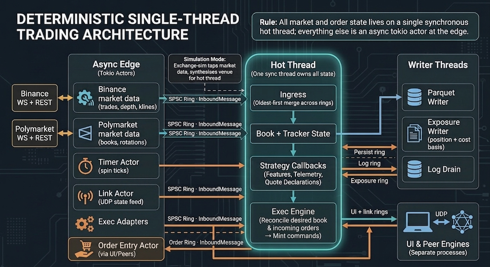
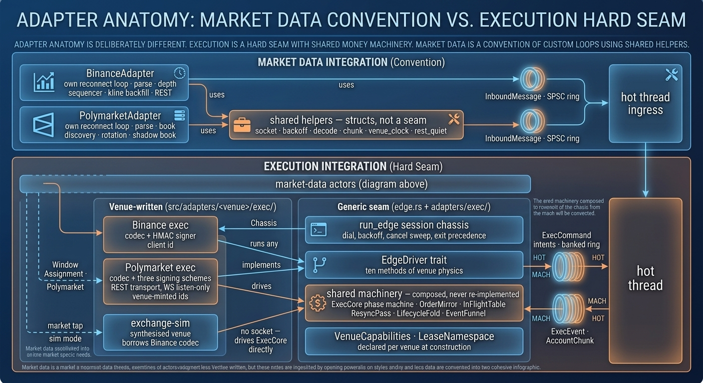

# polysim

A toy market making educational and visualisation tool for live simulation and data collection of running spike tests on market making strategies.

Yes, you can also execute live trades, but this is not the purpose of this tool.

This project is part of a personal project and experiment to see how high of code quality can be written when applying the right skills via the `rex-skills` cargo install.

Whether you are an engineer, hobbyist, student or whatever, the idea is that with cutting edge LLMs you have a foundation to learn from and work with.

The project is NOT optimised for latency. It is rather optimised for adaptability, whereby exchanges are popped on and off easily as adapters. The project uses a generic structure described below to help ensure any type of exchange could be bolted on. Right now the library does not support FIX although if time permits, will work on that perhaps in the future.

Note that live trading is untested and just there for now as a placeholder. This repo is NOT meant for live trading execution so please use at your own risk.

## Run

```shell
# Credentials — copy the template, then fill it in. .env is never tracked.
mv .env.example .env

# Trading engines — headless, one process per data source
cargo run --release --bin strat-micro-recorder-te-binance-spot-btcusdt
cargo run --release --bin strat-micro-recorder-te-polymarket-btc-updown-5m

# Browser workstation, one-time setup — the wasm32 target comes from rust-toolchain.toml.
cargo install --locked trunk

# Browser workstation, build and serve — Trunk fetches the wasm-bindgen and wasm-opt tools it needs
# on the first build. polysim-web attaches to running engines over UDP and needs the `web` feature.
# --link is repeatable: the page switches between the engines from its link bar.
(cd browser && trunk build --release)
cargo run --release --features web --bin polysim-web -- --strategy strat-micro-recorder --link 127.0.0.1:9310 --link 127.0.0.1:9311
# Add --mcp http://127.0.0.1:8765/mcp so the app descriptor also names the agent control plane below.
# Then open http://127.0.0.1:7879/ — or host the page in Jet: /app add 7879 "Polysim"

# Agent control plane — an MCP server over stdio by default, or over loopback HTTP with --http.
# Needs the `mcp` feature. Build it first: a cold release build can outlast an MCP host's start-up
# timeout.
cargo build --release --features mcp --bin polysim-mcp
cargo run -q --release --features mcp --bin polysim-mcp
cargo run -q --release --features mcp --bin polysim-mcp -- --http 8765
# A parent passes --watch-stdin and holds a stdin pipe open, so the server and engines end with it.

# Gate — all six must pass before anything merges, and both Trunk builds must succeed
cargo fmt --check
cargo clippy --all-targets -- -D warnings
cargo clippy --all-targets --all-features -- -D warnings
cargo clippy --target wasm32-unknown-unknown --lib --bin polysim-ui --bin dom-fixture -- -D warnings
cargo test
cargo test --all-features
(cd browser && trunk build --release)
(cd tools/dom-fixture && trunk build --release)

# ARM64 Linux binary for deployment, built in Docker, lands in dist/
./scripts/build-strategy.sh strat-micro-recorder-te-binance-spot-btcusdt

# ...which is a name check plus this. Run it directly if you prefer:
docker buildx build \
    --platform linux/arm64 \
    --build-arg BIN=strat-micro-recorder-te-binance-spot-btcusdt \
    --output type=local,dest=dist \
    .
```

`polysim-mcp` gives an agent four tools: `list_strategies`, `start_strategy`, `stop_strategy` and `set_execution_mode`. It starts each engine as a child process from its prebuilt release binary, and stops every engine it started when it exits. The `.mcp.json` at the repo root registers it for Claude Code.

A stdio server lives only as long as the client that spawned it, and stops every engine it started when that client exits. Use `--http <port>` when engines must outlive one client: the workstation and every `claude -p` reply then share one long-lived server and its engines. Start it once, then register it under the same name the tracked `.mcp.json` uses, so it replaces the stdio entry instead of sitting beside it:

```shell
claude mcp add --transport http polysim http://127.0.0.1:8765/mcp
```

That registration has local scope, which overrides the project entry. Under any other name every reply still spawns its own stdio server, and an engine started through that server dies with the reply. Ctrl-C or SIGTERM ends the HTTP server and stops every engine it started. It listens on 127.0.0.1 only, has no auth, and refuses requests from browser pages. `--engines <dir>` points either transport at another folder of prebuilt engine binaries.

## Browser workstation

The workstation is one egui app compiled to WebAssembly (bin `polysim-ui`, built by Trunk in `browser/`). It runs in a browser tab or in a Jet frame, with nothing to install. `polysim-web` is the small server in front of it. It listens on 127.0.0.1 only, on port 7879 unless `--port` says otherwise (`--port 0` lets the operating system pick), and serves three things:

- `/jet-app.json` — the app descriptor Jet reads. The UI uses relative paths only, so it works at `/` and behind Jet's `/apps/{id}/` proxy. `--mcp <url>` adds the address of `polysim-mcp` to it.
- The Trunk bundle from `browser/dist` (or `--bundle <dir>`), read into memory at start. The server refuses to start when there is no `index.html` there.
- `/api/link?peer=<n>` — a WebSocket to engine number `n` of the `--link` list.

The server never reads a link frame. Each open tab is an ordinary link subscriber whose UDP socket lives in the server, so the engine's own link guard, sequence gate and catalog apply to a tab as they do to any other subscriber. The relay protocol:

1. A tab opens `api/link?peer=<n>`, relative to the page. A peer outside the `--link` list is a 404. To move to the next engine, the tab closes its socket and opens the next index.
2. The first message is text: `{"strategy":…,"peers":[…],"tokenHash":…}`. It carries the hash of the link token, never the token.
3. After that, every binary message in either direction is exactly one link datagram, passed through untouched.
4. The server connects one UDP socket per tab to the engine, so the operating system drops datagrams from anyone else. A message longer than a link datagram (1,200 bytes) closes the socket. An engine that is down is not an error: the refusals are counted and the relay stays open. When a tab closes, one stderr line gives the counts.

The relay carries START and STOP with no login, so every request, WebSocket or not, passes a guard first. It needs exactly one `Host` header naming `127.0.0.1`, `localhost` or `[::1]` on the port the server really bound, which stops DNS rebinding. It allows at most one `Origin` header, which must be `http://` plus that same host, which stops another website from opening the relay (`null` is refused). Jet's proxy rewrites `Host`, and `Origin` when the browser sends one, so framed traffic passes. A frame load carries no `Origin`, so every response also allows only a same-origin parent to frame the page (`frame-ancestors 'self'`): another site cannot lay a decoy over START or STOP. Jet frames the page from its own origin, so it is unaffected.

Good to know:

- **Hidden tabs stay connected.** The link loop runs from the WebSocket's message callback and a one-second timer, so a hidden tab (or a hidden Jet frame) keeps its subscription and its data current. Only painting waits. Known limit: after about five minutes hidden, Chrome throttles that timer to about once a minute. A live link keeps itself going through incoming messages, but re-attaching after an engine restart can then take up to a minute.
- **A page opened in a hidden tab starts when it is first shown**, link included. eframe 0.35 loses the first frame's textures when it draws while hidden. eframe 0.36 fixes that and needs Rust 1.95, and this repo pins 1.92.
- **Esc closes nothing now**, because a page cannot close itself. The old 1200×700 minimum window is zoom-to-fit instead: a smaller page scales the layout down, to half size at most.
- **Each tab is its own subscriber and its own controller**, as two windows were. START or STOP in one tab takes control from the other, which then shows "control LOST to epoch N".

## Post Trade Analysis

Post-trade analysis lives in [`strategies/post-trade.ipynb`](strategies/post-trade.ipynb), reading the parquet a run records. The Python environment is managed by [uv](https://docs.astral.sh/uv/) and lives in `strategies/` beside its `pyproject.toml`:

```shell
cd strategies

# One-off: create .venv (Python >= 3.12), then install from uv.lock
uv venv
uv sync
```

Open the notebook with `strategies/.venv` selected as the kernel — `ipykernel` is already in the environment.

Go ahead and select you jupyter notebook and start analysing data.

## Live Tests

Live-network tests are `#[ignore]`d and never run in CI:

```shell
cargo test --test integration -- --ignored --nocapture --skip poly_exec
```

## Architecture

Here is a general high level view of how everything connects together.



How it actually works: one thread — a single line of execution on one core — owns the entire picture of the market and our orders, and nothing else is ever allowed to touch that picture. Around it sit small helpers: one per exchange connection, translating whatever Binance or Polymarket send into simple fixed-size messages and dropping them onto queues; even the clock is just a helper posting a tick message a few times a second. The main thread loops forever: take the oldest waiting message, update the picture, let the strategy react, decide which orders it now wants. It never talks to an exchange itself — it queues "place this, cancel that" instructions for a helper to send, and the exchange's answers (accepted, filled, rejected) come back as ordinary messages like everything else. Writing files happens on separate threads, fed the same way, so the main loop never waits on a disk or the network. Because only one thread touches the state, there are no locks and no race conditions; and because the state changes only in response to messages, in order, recording those messages and replaying them later reproduces the run exactly — which is what makes the simulations and the collected data trustworthy.

### Adapter Anatomy



Plugging in an exchange means writing two pieces, and they are deliberately not the same shape. The market-data piece is the easy half: every exchange gets its own small translator that connects, listens, and turns whatever that exchange broadcasts into the engine's one common message format. The translators share a toolbox — opening connections, retrying after a disconnect, parsing prices exactly — but each writes its own loop, because exchanges differ too much for a template to help. The order-sending piece is the strict half, because mistakes here cost money. Everything dangerous is shared code, written once: remembering which orders are alive, what to do when the connection drops mid-order, never sending the same order twice, cancelling everything on the way out. A new exchange only writes the translation — how to format, sign and send requests that venue understands, and how to read its replies — plus a short declaration of the venue's quirks: its fees, its rate limits, how its markets behave. The simulator slots into that same socket: it pretends to be the exchange, drives the same shared machinery, and the trading thread genuinely cannot tell the difference.

The order-sending half is governed by a written contract — every promise a venue integration must keep, and exactly what you would have to write to add the next exchange, lives in [`src/adapters/exec/README.md`](src/adapters/exec/README.md).
